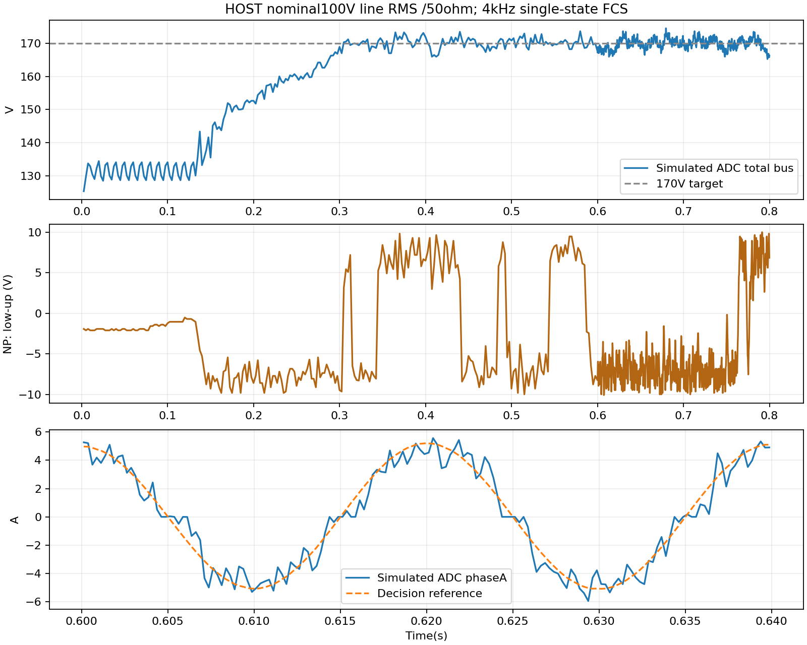

# Runtime4历史算法依据：Kernel12 / 4 kHz单状态FCS

当前运行层已更新为Runtime5，新增连续停止测试与CPU定时器观察，最新操作以
`CCS_CONTINUOUS_BENCH_GUIDE.md`为准（79项观察表）。本页Runtime4的识别值、OUT、71项表及567项测试数按历史保留。
本次Runtime5没有改变下面的预测算法、控制频率、PWM形式或保护配置。

2026-10-28。真实CCS源码已更新并构建成功，保持每周期一个开关组合。
名义HOST工况已完整运行0.8 s并实现约170 V调压；实机时限与带载尚未验证。
**现在先进行无主功率加载、识别与计时，不直接按100 V线RMS/50 ohm启机。**

## 立即操作

1. Refresh并Build现有子工程，不运行Clean/Rebuild。唯一源目录：

```text
D:/GraduateStudentProject/Vienna_Rectifier/Vienna_Project/Vienna_MPC/pfc3phvienna_new_mpc/pcmfpc_zcdc_target
```

2. 主功率断开。CPU1选择`Run > Load > Load Program`，加载本目录`FLASH/vienna_pcmfpc_zcdc_F2837x.out`。
   不使用外层历史工程、旧OUT或仅Reload Symbols。
3. 停在main后Resume，等待约6.25 s零偏校准/初始化完成，确认`VIENNA_pcmTick`增长。
4. 运行本目录`setupdebugenv_pcmfpc_zcdc.js`，或导入`CCS_Expressions_PCMFPC_ZCDC.txt`。两表为71项。
5. 确认识别值：

| 变量 | 新版值 |
|---|---:|
| VIENNA_pcmRuntimeRevision | 4 |
| PC_fast_kernel_revision | 12 |
| VIENNA_pcmTiming.revision | 2 |
| VIENNA_pcmTiming.control_hz | 4000 |
| VIENNA_pcmTiming.sample_us | 约250 |
| VIENNA_pcmTiming.first_duration_us | 约125 |
| VIENNA_pcmTiming.pwm_period_ticks | 25000 |
| VIENNA_pcmTiming.tbprd_ticks | 12500 |
| VIENNA_pcmTiming.period_cycles | 50000 |

6. 保持`HardwareRelease=0`、三环关闭、三相OST。单次写`VIENNA_pcmBenchRequest=5`，等待归零并记录`BenchCycles`；再单次写6并记录。
   正常`BenchStatus=1`、`CoreStatus=0`，`BenchCount`各增加1。
7. 同时记录`VIENNA_pcmBodyCyclesMax`、`VIENNA_pcmFault`和`VIENNA_fcsDeadlineMissCount`即可。
   本轮先测这一组新5/6，不用重复旧请求2或反复执行相同请求。

停止模式下AlgorithmCycles、prefetch.hits保持0可能完全正常：数值基准与live历史隔离。
加载识别优先看Runtime4/Kernel12/Timing2。`PC_engineering_diag`在首次快速计算后才形成有效诊断。

请求5包括PLL、两段FULL重构、ESO、新快速核和末级后处理。
请求6使用相同夹具，但在计时前完成重构，测量缓存后的计算路径；HOST已证明完整PC_Output逐字节一致。
BodyCycles仍包含请求6的准备，**总运算没有消失**；5/6都不是完整写前路径/整ISR/WCET。
请求1保留原32次二分数值参考；2快速核；3阶段profile；4细分root profile；7以上非法。
细分profile副本放在FLASH，不能用请求4的周期数冒充普通RAM控制耗时。

CPU按配置200 MHz时：`时间us = cycles/200`。
本次TI汇编确认CMPB=12315，CMPC从CMPB读取；ISR到ZERO为123.15 us，扣原40 TBCLK写入guard后为
**122.75 us / 24550 CPU cycles**。请求6还不含全部ADC读取、判断和PWM写入，低于24550只是必要条件。
旧2 kHz的19732/27718/29912及旧OUT不能作为本版实时性证据。

## 本次实际改动

`vienna_pcmfpc_fast.c::PC_run_fast`是工程化单状态FCS核，保留8个物理门极、阻断预测、ESO、
独立双排序、0.02 A误差范数预算和共同触发末级。它是明确的模式7工程变体，不是原论文逐式版本，也没有换回加权FCS。

1. **长区间模型**：每段仍2子步；动态更新总母线并继承首段末母线，Fhat按原采样dq锚点修正R/L与旋转项。
   总母线模型引入固定50 ohm负载依赖，不能把它当作任意负载均已验证。
2. **硬可行集合**：首段实测/预测节点电流<7 A、中点差绝对值<50 V；候选共同起点与各节点也检查7 A/50 V。
3. **未来预留**：候选两个未来next节点及末端<6.5 A。共享起点仍按7 A检查，不会因已知起点略高于6.5就误拒绝全部候选。
   0.5 A为控制设计预留，未证明是实机误差界；实际HOST峰值6.604 A也说明它不是连续电流钳位。
4. **中点分层软恢复**：计算`max(0,abs(np2)-max(10 V,0.95*abs(np1)))`，只在硬安全候选中保留最小违约者，
   再使用原排序预算。恢复目标不可达不会强迫选不安全状态，也不会单纯因此停机。
   10 V/0.95为新增正常控制设计目标，不是硬件保护阈值；7 A、204 V、原GUI半母线差50 V等保护保持。
5. **末级投影**：角度改善不能降低相对共同PC-OFF的参考方向电流投影，避免以减小供能换取角度改善。

硬集合为空或不可避免首段不满足约束时返回0x101/0x100，运行层按原故障路径Trip并停止。
诊断结构中的mask以MATLAB候选ID1..8对应bit0..7；硬件位仍bit0=A、bit1=B、bit2=C。
诊断只输出，不从CCS可写观察对象读取控制mask或参数。

`vienna_pcmfpc_runtime.c::pc_prefetch_observer`在门极写后准备下一拍MODEL电压积分，
`VIENNA_PCMFPC_sample`按tick、sequence、门极、mode/root校验后消费一次。
原公开`PC_fast_predict_interval`/FULL重构仍为固定母线、冻结Fhat模型，不读取新前瞻锚点，避免偷偷改变ESO对照。
正常缓存路径与独立同步重构的整个ESO状态逐字节一致；无expected时同步fallback，expected错配则故障。
post重构失败可能比旧同步路径提前一拍故障，不能称所有异常时序完全不变。

实际控制仅允许Mode1/2、RootMethod1，防止原参考路径绕过新可行集合。
Mode0在该子工程仅作停止/影子诊断；原FCS需要运行main独立工程。默认Mode0、HardwareRelease0，不自动启动或清Trip。

## 已完成与未完成

| 证据 | 结果 |
|---|---|
| 实际工程运行适配层HOST检查 | 567项通过 |
| 集成核契约与原公开FULL对照 | 83项通过；公开FULL保持原10逐字节一致 |
| 原型与通过版逐拍门极对照 | 2960次，0项不一致 |
| 实际当前源码名义闭环 | 完整0.8 s，7 A/204 V未触发，core/ESO错误0 |
| TI CGT25.11.1.LTS增量编译/链接 | 最终0错误、0警告 |
| 实机写前路径/ISR/WCET、栈峰值 | 尚未测量 |
| 实机低压及100 V/50 ohm闭环 | 尚未验证 |

名义案例为3 mH、0.2 ohm、每半440 uF、50 ohm、100 V线RMS/50 Hz。
完整0.6~0.8 s物理模型统计：

| 指标 | 结果 |
|---|---:|
| 总母线均值 | 169.733 V |
| 总母线纹波 | 9.725 Vpp |
| 全程电流峰值 | 6.604 A |
| 稳态中点差RMS/峰值 | 7.175 / 10.102 V |
| 三相电流THD | 11.89% / 11.48% / 13.20% |
| PF | 0.9662 |

这说明名义模型能够持续调压，但电流过零畸变、纹波和中点偏差仍需改进，不能称论文性能或硬件资格已达成。
HOST采用0.5 us独立abc物理步长、近似传感链及理想器件，没有复现全部目标保护滤波、IRQ调度、实际启动和器件误差。



最终OUT：`FLASH/vienna_pcmfpc_zcdc_F2837x.out`

```text
SHA256 719730867f2affa96fadc197a401818ebd1f22ef9782d14760f9196596439f1a
```

RAM算法区15553/16384个C28字，余831；BSS3650/4096字，余446；栈分配896字。
为容纳新增逻辑，把仅用于停机数值计时的重复模型体放到独立FLASH section，普通控制体仍在RAM。
不扩RAM、不搬移保护/ADC/PWM代码；链接启动段.cinit保留原FLASHB空间。
初次RAM/FLASH布局失败日志保留，最终构建以native_pass3为准。

源码绑定构建审计：`validation/SINGLE_FCS_4KHZ_BUILD_AUDIT.json`；统计：`validation/SINGLE_FCS_4KHZ_REPORT.json`。
旧`control_rate_2khz_build_audit.json`仅为历史2 kHz证据，不再表示当前固件。
完整源码快照、原始波形、失败与成功日志在项目根output/ti_pcmfpc_zcdc_port/integrated_single_fcs。

重现HOST测试：

```powershell
python tests/validate_integrated_single_fcs.py --output D:/GraduateStudentProject/Vienna_Rectifier/output/ti_pcmfpc_zcdc_port/integrated_single_fcs/validation_replay1
```

需本机Clang/Visual Studio工具链，可用--clang/--vcvars指定；输出非空则拒绝覆盖，不执行清理。
本轮没有工具连接/烧录/清Trip/写板卡，没有删除文件，没有Git提交或推送；main分支和父级Kit.json改动保留。
