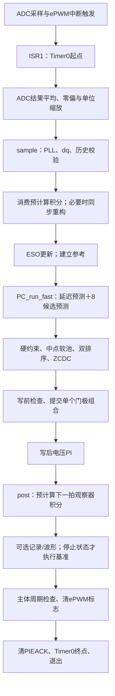

# F28379D PCMFPC-ZCDC 算法执行流程与耗时分析报告

源码分析日期：2026-10-28；报告核对完成日期：2026-10-29。分析对象：`new_mpc` 分支的 `pcmfpc_zcdc_target`。34个源码、配置及编译产物的SHA在最终核对时保持一致。本次仅读取工程、历史测量和现有汇编，新增报告及分析附件；未修改控制源码、外设或保护参数，未重新编译，未访问目标板。

## 1. 主要结论

当前一百多微秒的主要计算负担，是**对多个开关状态重复执行含二极管阻断、坐标变换和母线动态的预测模型，以及为观察器重构历史极点电压积分**。`for` 是组织这些运算的结构；循环体中的数学和数据访问才是主要工作量，不能靠删除 `for` 关键字消除。

正常成功完成一次快速核，需要：

- 一个已施加开关状态的延迟预测区间，每区间两个子步。
- 八个候选开关状态，每个候选两个子步。
- 合计 **18次控制模型分段求根**，之后才形成约束集合、双排序和末级选择。
- 两段历史门极区间的持续时间均大于零时，观察器电压积分重构另有 **4次FULL模型求根和4次极点电压积分**。门极组合为0也需要计算；这4次不包含在快速核的18次里。

已有旧版板上分段数据支持“候选预测是第一大开销”：第7、9轮的候选阶段分别占其粗分段总时间约 **68.95%、67.24%**；旧版细分数据中求根窗口约占总时间四成，求根窗口外的预测工作也占三至四成。**这些比例属于旧内核，不能当作当前Kernel12的精确占比。** 当前尚缺同版本、同路径的完整分段实测。

已有4 kHz用户截图中，请求5为163.165 µs，请求6内部计时为123.970 µs，C主体累计最大值174.570 µs，均按配置200 MHz换算。这三个值测量范围不同，不能统称“纯算法时间”。

## 2. 分析版本和证据边界

当前源码的唯一工程目录：

```text
D:/GraduateStudentProject/Vienna_Rectifier/Vienna_Project/Vienna_MPC/pfc3phvienna_new_mpc/pcmfpc_zcdc_target
```

下文表格中的文件名均相对这个目录，行号以本次快照为准；后文关键文件提供绝对路径链接。

| 项目 | 核查结果 |
|---|---|
| 控制卡/CPU配置 | F28379D，CPU1，200 MHz |
| 当前控制频率 | 4 kHz，周期250 µs |
| 模型首段/候选区间 | 125 µs / 250 µs，各分两个子步 |
| 运行层源码 | Runtime5 |
| 快速核标记 | 首次执行 `PC_run_fast()` 后为12；全局初值仍为10，刚初始化不一定已经显示12 |
| 当前控制求根 | PIECEWISE；默认 `PC_FAST_LEGACY_CONTROL_ROOT=0` |
| 门极输出形式 | 每周期一个三相开关组合，非固定占空比调制 |
| 工程参数背景 | 每相3 mH、R模型0.2 Ω、每半母线440 µF、固定50 Ω负载模型、目标170 V |
| 本次新板上实测 | 无；只使用用户既有截图/文字与历史归档 |

本次读取到的最新OUT链接时间为2026-10-28 22:06:41，SHA256为：

```text
97d356cb26254f0a62e328a07c481b155d4f249c57757f64b9b04705e49ce181
```

它已经不同于上一次连续测试交付审计中的 `c575581f...`。当前 `fast.c`、`runtime.c`、`observer.c` 与那次审计的SHA一致；`vienna_main.c` 已由用户调整为 `IntruDifPoint=IntruStratPoint+IntruEndPoint`，本次读取的main汇编也已出现对应ADD。因此不能再拿旧OUT指纹代表当前构建，更不能把之前截图自动绑定到这个新OUT。

本次证据包含34个源码、配置及编译产物的SHA，见：

```text
D:/GraduateStudentProject/Vienna_Rectifier/output/ti_pcmfpc_zcdc_port/algorithm_timing_analysis_20261028/EVIDENCE.json
```

## 3. 先区分各个“执行时间”

| 观察量 | 覆盖范围 | 不代表什么 |
|---|---|---|
| `BenchCycles`，请求2 | 固定输入的快速核选择包装及末级投影保护 | 不含真实ADC、PLL、ESO及门极提交 |
| `BenchCycles`，请求3 | 同类快速核夹具，加入阶段计时 | 不等于无计时插桩的请求2 |
| `BenchCycles`，请求4 | 加入每个root窗口的细分计时 | 当前走专门FLASH副本，不代表普通RAM核的根耗时 |
| `BenchCycles`，请求5 | 独立PLL、FULL积分重构、已初始化ESO更新、快速核和末级保护 | 不含夹具warm prepare、真实ADC/HAL提交；非完整ISR |
| `BenchCycles`，请求6 | 与5同夹具，FULL重构在内部计时前完成 | 只把重构移出这个内部计时窗口，整拍仍做了它 |
| `AlgorithmCycles` | `VIENNA_PCMFPC_select()`检查、快速核、末级保护 | 不含sample、PLL/ESO、参考变换、门极写入与post |
| `WriteCycles` | 从控制C主体入口到门极写入后的记录点 | 不含后置观察器预计算、记录等 |
| `BodyCycles/Max` | 控制C主体入口到post末尾，含后置工作和停止基准 | 不含完整中断入口/出口及main后续计时运算 |
| `IntruTime_us/Max` | Timer0两次读取之间：控制函数、PIE清除及捕获读数 | 不含ISR序言、尾声和之后的换算/统计；非完整硬件中断延迟 |

位置：`runtime.c:161/197/222`分别是夹具准备、流水线和请求调度；`:513`选择计时、`:533`提交计时、`:598/668`后处理主体计时；`main.c:206`为ISR1。

停止基准在本拍OFF门极提交之后才执行，结果门极不交给HAL。它的 `DeadlineMissCount=0` 不能证明基准算法满足写前期限。停止时 `AlgorithmCycles=0`、prefetch命中次数为0，也不等于快速核没有在基准中运行。

## 4. 整个工程的执行流程

### 4.1 启动阶段：不计入每拍算法耗时

`main()`初始化设备、CPU定时器、三相ePWM、ADC、全局变量和PCMFPC配置，开启触发，完成零偏校准，配置保护，注册中断，最后进入后台状态机。

`vienna.c:447::VIENNA_calibrateOffset()`中的25000次采样校准，在4 kHz配置下约6.25 s，只发生在启动。`VO_configure()`中的 `expf()`也只用于初始化观察器系数，不是每拍都计算指数。

### 4.2 正常电流闭环的ISR1路径



| 顺序 | 文件、函数 | 实际工作 |
|---|---|---|
| 1 | `vienna_main.c:206::ISR1()` | 读取Timer0起点、TBCTR，调用控制C主体 |
| 2 | `vienna.h:339::VIENNA_readCurrVolADCSignals()` | 三电流、三交流电压、两半母线；每路四个结果平均，源码级32次ADC结果读；没有等待转换的忙循环 |
| 3 | `runtime.c:368::VIENNA_PCMFPC_sample()` | 输入有限值检查、实际/待应用门极及模式检查、PLL同步、测量dq |
| 4 | `grid_sync.c:60::VG_run()` | Clarke/Park、幅值、PI同步、相序和锁定检查；未锁定会早退 |
| 5 | `runtime.c:433`附近 | 消费已预计算的历史积分，校验tick/sequence/gate/mode/root；无expected缓存时可同步重构 |
| 6 | `observer.c:46::VO_update_delta()` | 两轴状态及扰动估计更新；保存本拍历史 |
| 7 | `runtime.c:503::VIENNA_PCMFPC_make_refs()` | dq电流参考转abc，更新控制/观察参考 |
| 8 | `runtime.c:513::VIENNA_PCMFPC_select()` | 调用 `pc_run_selected()` → `PC_run_fast()` → `terminal_guard()` |
| 9 | `vienna.h:697/709` | 方向与提交guard检查；`VIENNA_HAL_updateFCSState()`写入三相门极组合，记录WriteCycles |
| 10 | `vienna.h:753/756`、`runtime.c:577::outer()` | 当前PCMFPC电压PI在ISR1门极提交之后执行，更新后续电流参考 |
| 11 | `runtime.c:598::VIENNA_PCMFPC_post()` | 后置观察器积分预计算、可选影子计算/记录/波形、停止基准；最后主体周期检查 |
| 12 | `vienna.h:867`、`main.c:212` | 清ePWM外设标志、清PIE应答、读取结束计时，退出中断 |

以上是正常成功路径。停止、PLL未锁、故障、缓存失配、空可行集合等路径会提前返回或Trip，执行量与此不同。不能拿停止短路径时间代表正常预测控制。

### 4.3 ISR2和后台任务

`vienna_main.c::ISR2()` → `vienna.h:877::VIENNA_instrumentationCode()`执行参考电压斜坡、GUI/RMS/功率统计、软件保护和日志等。其配置仍为10 kHz。它允许ISR1抢占，但ISR1没有开启普通中断嵌套，所以ISR2不会插入正在执行的ISR1。

电压PI不能笼统归到ISR2：本工程PCMFPC的实际PI位置见上表第10项。ISR1若持续占用较长时间，ISR2的响应/更新节拍可能受到影响；目前没有其实际执行频率及总CPU负载的完整实测。

## 5. 快速预测核逐步展开

入口为 `vienna_pcmfpc_fast.c:1013::PC_run_fast()`。当前不是简单线性一步电流预测，也不是穷举八乘八个状态序列。

### 5.1 输入、旋转节点及延迟补偿

入口做结果摘要初始化、参数/输入检查、实测三相电流和电压转dq，并以当前采样dq建立扰动锚点。

`pf_plan():311`为125 µs首段建立三个旋转节点，将区间分成两个62.5 µs子步。`pf_control_interval():838`用已施加门极预测至候选区间起点，得到共同的 `idq1_A`、中点差及总母线。

首段同时检查7 A电流和50 V中点硬边界，不能把所有约束都拖到最后。模型首段125 µs是配置的预测时间，不能与软件实际剩余写入窗口混为一谈。

### 5.2 共享候选准备

`pf_plan()`为250 µs候选区间建立三个节点，子步125 µs；`pf_seed():375`只计算一次八候选共有的首子步old/free电流及二极管事件计划。

这是已有的减算：共同起点和旋转计划不在每个候选里重算。但是每个候选的开关约束不同，第一子步的根/电流不同；进入第二子步后状态分开，仍需分别预测。

### 5.3 八候选批处理

`pf_candidate_batch():852`设置 `count=8`，进入 `pf_control_interval_plain():824`。其 `PF_CONTROL_CORE` 的候选循环对每个状态执行两个固定宏子步：

```text
首段：当前已施加状态 ── 子步1 ── 子步2 ── 共同起点
                                            ├─ 候选0：子步1 ── 子步2
                                            ├─ 候选1：子步1 ── 子步2
                                            ├─ ……
                                            └─ 候选7：子步1 ── 子步2
```

因此正常完整调用有 `2 + 8×2 = 18` 次CONTROL求根。两子步已经通过宏固定展开，并不是尚未处理的动态 `for(step<2)`。

所有八候选预测完成以后才形成硬可行集合。当前即使一个候选最终不合格，正常路径中也已经支付了它的两步模型计算；没有实现这种条件下的提前剪枝。

### 5.4 每个子步具体做什么

核心在 `PF_CONTROL_STEP:726`，主要工作包括：

1. 根据总母线和中点差恢复上下半母线，检查有效性。
2. dq状态自由预测并反变换到abc；候选首子步复用共享seed。
3. 根据开关组合求解二极管导通/阻断下的中性点约束。
4. 更新相电流峰值、未来峰值、阻断标记和有限值检查。
5. 预测电流从abc变回dq，积分中点差。
6. 更新总母线动态并检查半母线正值条件。

扰动增量修正为：

\[
f_d=\hat f_d-\frac RL(i_d-i_{d0})+\omega(i_q-i_{q0}),\qquad
f_q=\hat f_q-\frac RL(i_q-i_{q0})-\omega(i_d-i_{d0}).
\]

自由预测为 `i_free_dq = i_dq + h f`。令 `q` 为自由预测电流的abc值、`c=h/L`、`lambda=c*mu`、`cu=c*Vup`、`cl=c*Vlow`，当前CONTROL分段模型为：

\[
i_r^+=\begin{cases}
q_r+\lambda,&\text{该相双向开关ON},\\
\max(q_r+\lambda-cu,0)+\min(q_r+\lambda+cl,0),&\text{该相开关OFF}.
\end{cases}
\qquad \sum_r i_r^+=0.
\]

这使零电流阻断自然进入预测，却带来了事件判断、分段选择和残差检查。它不是仅三次乘加即可完成的一步线性模型。

中点更新使用ON相平均电流，总母线动态使用OFF相平均电流的绝对值：

\[
n^+=n+\frac hC\sum_{\rm ON}\frac{i_{old}+i_{next}}2,
\qquad
U_{dc}^+=U_{dc}+\frac hC\left(\sum_{\rm OFF}\left|\frac{i_{old}+i_{next}}2\right|-\frac{2U_{dc}}{50}\right).
\]

这里 `n=Vlow−Vup`，`C`为每半母线电容。50 Ω已经进入当前总母线模型；这些新增动态/约束检查也有计算成本，但没有同版本A/B实测，不能单独量化它们增加了多少微秒。

### 5.5 硬约束、中点软池、双排序及末级

候选代价在 `PF_CONTROL_CORE:813`附近形成：

\[
g_i=(i_{d,2}-i_d^*)^2+(i_{q,2}-i_q^*)^2,\qquad g_u=n_2^2.
\]

随后按以下顺序选择：

1. 合并预测峰值7 A、未来节点6.5 A预留、中点50 V的硬可行mask。
2. 对中点软恢复目标 `max(10 V,0.95*abs(n1))`，计算违约量，只保留硬集合中违约最小者。
3. `pf_rank():970`独立按电流优先和中点优先排序；相同代价按另一代价、开关变化数、候选ID确定顺序。
4. 取电流排序前至多三个，在 `sqrt(best_gi)+delta_i`预算内形成mask。
5. `pf_intersection():988`调整中点排序前缀，找到一至两个交集候选。
6. 满足过零窗口、电压余量/阻断条件后，对交集作末级角度比较，并限制参考方向电流投影不低于基准。
7. 映射MATLAB候选ID到硬件三位开关状态，写输出和诊断。

这里是分层约束与双排序选择，没有把当前选择偷偷改成 `gi + 权重*gu`。

**`pc_off_id`表示未启用末级过零补偿时的基准最优候选，不等于物理全部关断 `hw=0`。** 末级复用已经得到的候选电流，不会再对交集重复做两步模型求根。正常末级最多一至两次角度评价，而非八次。

## 6. 究竟哪些循环有开销

| 代码位置 | 循环上界/次数 | 循环体的主要工作 | 判断 |
|---|---|---|---|
| `PF_CONTROL_CORE:804` | 候选8次；首段另1次 | 每次两子步模型、求根、坐标变换、母线与约束统计 | 主要重复工作入口 |
| `PF_CONTROL_STEP:726` | 固定两段宏展开 | 大量浮点与状态更新 | 已经展开，不能再把“展开两步for”当新方案 |
| `pf_lambda_root:657` | 最多三个内部事件、四段 | 活跃集合、分段解析根、投影残差 | 有界、随数据改变分支；不是未知次数收敛循环 |
| `pf_lambda_dense_root:550` | 两ON最多两段；三ON一段 | 特化闭式根及残差 | 已有状态特化减算 |
| `pf_lambda_plan:339` | 三相、最多三个事件 | 建断点、排序 | 规模很小，反复调用后仍有累积成本 |
| `pf_rank:970`，调用两次 | 每次N≤8，最多28次插入比较/移动 | 代价、平局规则及数组读写 | 次要优化目标，不能据O(N²)断言它最慢 |
| `pf_intersection:988` | 外层≤8；保守≤64次位测试 | 前缀mask相交 | 有界的小集合处理 |
| `VO_reconstruct:104` | 两段×两子步 | FULL模型和解析电压积分 | 另一块重要计算量 |
| ADC/ESO/三相检查 | 固定2/3/4/8项 | 读数、缩放、两轴更新等 | 不应因为也有for就误认为主瓶颈 |
| 启动零偏校准 | 25000次，只启动时 | 等待采样并平均零偏 | 不属于每拍100多微秒 |

`while`也不是一律危险：断点/候选插入排序的索引每次减小且数组很小，不是无限等待。把循环手写成八份相同代码，最多改变循环控制、调度和寻址；八个状态对应的数学工作依旧存在，且代码体积可能增加。

### 正常快速核的源码级工作数量

| 操作 | 次数 |
|---|---:|
| CONTROL求根 | 18 |
| `pf_rotation()`，每次sin/cos一对 | 8 |
| `pf_abc_to_dq()` | 20 |
| `pf_dq_to_abc()` | 33 |
| `od_f()`轴修正 | 22 |
| `od_dc_step()` | 18 |
| 正常末级角度评价 | 不激活为0；激活为1–2 |

计数条件是正常完整路径、无错误提前返回、非全角度诊断。变换已经复用旋转值，不能把20次dq变换误写成20次各自重新求sin/cos。这些是源码工作量，编译器可能内联、消常量或重排；不能直接乘一个固定指令周期来宣称精确耗时。

## 7. 求根已经减算，为何仍然不快

保留参考入口 `vienna_pcmfpc_zcdc.c:283::PC_run()`的32轮二分路径，在18个子步中至少有 `18×32=576` 次二分中点投影，另有端点和残差计算。当前正常快速核不走这个循环；参考入口主要用于停止请求1对照。

当前 `lambda`根利用各段的 `H(lambda)=B+N*lambda` 直接求解，最多四段。八候选中，硬件状态3/5/6/7走dense特化，其余0/1/2/4走generic；首段的两个求根取决于实际已施加状态。

这确实降低了根求解工作，但没有消除：

- 18次预测所需的状态准备、坐标变换、峰值/中点检查及存储。
- 构造二极管活跃集合、浮点边界判断、最终残差验证。
- 观察器另四次FULL根和极点电压积分。
- 双排序、预算、交集、末级判定、运行层及HAL开销。

双排序把末级角度比较压到一至两个候选，但位置在八候选预测之后。因此不能据“最后只比较两个候选”推断前面只预测了两个状态。

当前工程变体还增加了动态总母线、扰动锚定修正及可行性/恢复约束；不能用早期约95 µs的裸核结果，代表今天包含更多工作的完整基准。控制频率降低后，固定候选/子步数也没有自动减少；物理区间变长还可能改变二极管事件和选态分支。

算法方法有创新，与某块MCU上的具体实现一定更快，是两件需要分别验证的事情。当前没有同精度、同预测模型、同诊断范围的传统线性FCS实机A/B，不能给出相对其加速倍数。

## 8. 观察器为什么额外花时间

`VO_update_delta():46`本身主要是两轴预测、创新和扰动校正：

\[
i_{prior}=\hat i-\Delta u/L+T_s\hat f,\quad
e_i=i_{meas}-i_{prior},\quad
\hat i^+=i_{prior}+k_i e_i,\quad
\hat f^+=\hat f+k_f e_i.
\]

真正重的是没有极点电压传感器时，必须为 `Delta u` 重构已执行门极的电压积分：

```text
VO_reconstruct()
  ├─ 门极变化前区间：FULL预测2子步 → 2次根 → 2次极点电压积分
  └─ 门极变化后区间：FULL预测2子步 → 2次根 → 2次极点电压积分
```

`PC_fast_predict_interval():930` → `pf_interval():866`保留公开FULL模型，提供极点电压、子步和积分。它是固定总母线/冻结Fhat的兼容重构路径，与CONTROL用的动态DC、增量F模型不能混为一谈。

`VO_integrate_pole_segment():90`对旋转dq电压作解析积分，包括 `sinc(x)` 与中间角度sin/cos。在当前4 kHz、50 Hz、两段各125 µs时，重构的源码级三角求值合计24个，即14个sin、10个cos；TMU可能内联，不能解释成24次慢软件库调用。

写后 `pc_prefetch_observer():543`提前准备下一拍会用到的积分，下一拍按历史验证后消费。**它转移了写前关键路径的负担，整ISR里仍须完成重构。** 正常缓存命中不会再重构一次；异常/初始无缓存的回退路径需要单独看待。

请求6也只是把同夹具重构移出 `BenchCycles` 的内部窗口：`BodyCycles`、`IntruTime_us`依旧包含准备成本。不能直接从完整中断时间里减去5/6差值。

## 9. 已有计时证据能说明多少

### 9.1 旧第7轮：完整粗分段

以下均为旧50 kHz/Kernel7，按配置200 MHz换算；一次固定夹具，不是当前Kernel12实测。

| 阶段 | cycles | µs | 占粗分段总时间 |
|---|---:|---:|---:|
| 初始化/检查/首段计划 | 814 | 4.070 | 3.79% |
| 已施加状态延迟预测 | 1783 | 8.915 | 8.29% |
| 候选公共计划/seed | 591 | 2.955 | 2.75% |
| 八候选预测及其代价 | 14823 | 74.115 | 68.95% |
| 双排序/预算/交集 | 2142 | 10.710 | 9.96% |
| 末级激活准备 | 470 | 2.350 | 2.19% |
| 末级角度评价 | 470 | 2.350 | 2.19% |
| 输出收尾 | 404 | 2.020 | 1.88% |
| 合计 | 21497 | 107.485 | 100% |

同轮无阶段计时的请求2为21138 cycles，即105.690 µs，不能拿它与上表分段拼成一次测量。

### 9.2 求根和根以外工作：互不重复计数

| 旧版细分测量 | 总cycles | 根窗口 | 预测阶段中根窗口以外 | 其他阶段 |
|---|---:|---:|---:|---:|
| Kernel7请求4 | 22817 | 9005，39.47% | 8921，39.10% | 4891，21.44% |
| Kernel9请求4 | 21070 | 8840，41.96% | 7348，34.87% | 4882，23.17% |

第9轮粗分段候选为13179/19600 cycles，约67.24%，仍与候选预测占主导相符。

**root窗口已经包含在delay/candidates里面，不能再额外加到总时间上。** `root_cycles=0`在粗分段mode1仅表示未逐根计时，不能理解为没有求根。细分插桩及其编译布局也有扰动，不能按读钟次数简单扣出“精确无插桩根时间”。

当前Kernel12更把细分profile副本放到了FLASH，当前请求4尤其不能直接替代普通RAM控制路径的根耗时。

### 9.3 现有4 kHz用户反馈

该组截图显示Timing2/4000 Hz，发生在新增Runtime5连续测试之前，按当时操作流程对应Runtime4/Kernel12；截图没有同时展示Runtime标记，也没有目标OUT哈希。本表保留这个版本关联限制。

| 测量 | cycles | 配置200 MHz下时间 |
|---|---:|---:|
| 单次请求5 | 32633 | 163.165 µs |
| 单次请求6 | 24794 | 123.970 µs |
| 两次内部区间差 | 7839 | 39.195 µs |
| C主体累计最大值 | 34914 | 174.570 µs |

约39.2 µs的差值支持“FULL重构及相关路径是一块重要成本”，但并非隔离测出的纯 `VO_reconstruct()` 函数时间；调用、数据搬运和区间布局也在其中。累计最大值和单次基准值不保证来自同一拍，不能做严格逐项相减。

用户后来两断点的 `12296向下 → 5241向上`，若仅跨一次ZERO、没有额外整周期且断点暂停时ePWM冻结，则为17537个TBCLK，即175.37 µs。它与约175 µs主体处在同一量级；断点位置和停机行为使其不能当作无扰动精确整ISR测量。


图左是旧Kernel7分段，图右是已有4 kHz不同区间；版本和测量范围不同，不能横向当作同一函数的优化前后，也不能把图右各条相加。

## 10. 已启用硬件浮点，瓶颈不能归因于“没开FPU”

当前`.cproject`和汇编确认：`FPU32`、`TMU0`、`-O2`、`opt_for_speed=5`、`fp_mode=relaxed`、`float_operations_allowed=32`已经启用。

`FLASH/vienna_pcmfpc_fast.asm`中可以看到 `DIVF32`、`DIV2PIF32`、`SINPUF32`、`COSPUF32`、`ATANPUF32`、`SQRTF32`。因此三角、根号、除法有成本，但已在使用硬件支持。TI说明TMU与relaxed模式可将这些单精度数学运算转为对应硬件指令：[TI编译选项与TMU说明](https://software-dl.ti.com/C2000/docs/optimization_guide/phase1/compiler_options.html#enable-tmu)。

DSP的 `PC_Real` 是float；`PC_REAL_TYPE=double`是HOST对照用的编译分支。不能看到源码中的double分支就判断DSP正在慢速双精度执行。TI另指出EABI下double为64位，可用 `float_operations_allowed=32`检查误引入双精度：[TI浮点精度说明](https://software-dl.ti.com/C2000/docs/optimization_guide/phase1/floating_point.html)。

仍可在汇编中看到模型/求根/排序函数调用、栈相对读写和静态工作区访问。这些都会占时间，但未单独测量，不能宣布某条除法或某次栈访问占了当前耗时的具体百分比。

| 当前编译器静态帧 | C28x的16-bit字数 |
|---|---:|
| `PC_run_fast` | 70 |
| `pf_control_interval_plain` | 104 |
| `pf_interval`，FULL路径 | 112 |
| `VO_reconstruct` | 162 |
| `PC_fast_predict_interval` | 40 |
| `pf_lambda_dense_root` / `pf_lambda_root` | 28 / 18 |
| `pf_rank` | 14 |

静态帧不等于完整调用链栈峰值，也不等于执行时间，不能据此断言发生栈溢出。

普通 `pcmfpc_code`运行于RAM；当前 `PC_run_fast` 位于0x19089、`VO_reconstruct`位于0x1b7b8。细分profile副本在FLASHE 0x88000；基准流水线和prefetch包装函数在FLASH。不同路径的代码放置会影响比较，但不能把全部差值都归因于FLASH。

当前RAM代码15595/16384字，余789字；BSS所在RAMGS3余446字；RAMM1余73字，其中已预留896字stack。后续不能无限展开/内联或复制RAM函数，必须兼顾代码空间和栈水位。

## 11. 确定结论、待验证判断与当前限制

| 结论 | 证据等级 |
|---|---|
| 正常快速核18次CONTROL求根；观察器另4次FULL根 | 当前源码确定；异常早退不在该计数内 |
| 循环体的模型/根/变换是主要工作，候选预测值得优先分析 | 当前结构确定，且旧分段实测支持 |
| 旧Kernel7/9候选约占67–69%、根窗口约四成 | 仅对应那些旧版固定夹具实测 |
| 当前Kernel12也精确占同样比例 | 未测，不能下结论 |
| 观察器重构相关路径约占额外39.2 µs | 现有5/6同夹具差值估计，不是隔离函数实测 |
| 当前第一慢指令一定是sin、atan2或除法 | 未证明；不能凭函数名称决定 |
| 展开for、全部内联一定更快 | 未证明，可能增加代码、寄存器和栈压力 |
| 硬件FPU/TMU已经启用 | 当前配置、原生汇编确定 |
| 每拍ESO在调用expf | 不成立；expf在配置阶段 |
| 开启ISR1嵌套能够加快算法 | 不成立；不增加运算能力，且当前模型共享静态工作区不具备重入性 |
| 当前小于250 µs就能准时写入门极 | 不成立；还受更短写前窗口约束 |
| 已有固定夹具或名义HOST案例等于全工况WCET/带载验证 | 不成立 |

4 kHz整周期为250 µs/50000 CPU cycles。现有CMPB/CMPC=12315、TBCLK100 MHz，ISR触发到下一ZERO约123.15 µs；扣40个TBCLK guard，写前预算 **122.75 µs/24550 CPU cycles**。模型首段125 µs、写前122.75 µs和全周期250 µs是不同量。

请求6为123.970 µs，比上述写前预算多1.220 µs，但该夹具不是真实完整ADC→HAL路径，不能据此确定live恰好多超时1.220 µs；它也不能证明live合格。

若某种路径每拍都耗时175 µs，则仅ISR1就约占4 kHz周期的70%；这是预算估算，不是已测正常闭环CPU负载。ISR2/后台余量、真实输入分支、最坏零交叉、异常回退、记录开启及栈水位还需测量。

当前main使用的 `Start+End` 只适用于向下跨ZERO后向上的特定计数路径；同向计数、跨PRD或额外周期时不成立。本报告没有改回它，实际耗时仍优先看Timer0捕获量。

## 12. 后续优化和验证的推荐顺序

本节是计划，不是本次已经实施的修改，不改变当前任何参数。

### 第一优先：补齐当前版本归因

对同一个明确OUT、相同root和夹具，保留无断点请求2及请求3阶段profile。记录Runtime、执行后的Kernel、Timing、`mode/valid/completed/core_status/clock_fault`、八阶段、总cycles、计时读数次数及角度次数。粗分段mode1没有逐根窗口计时，`root_cycles/root_calls=0`是正常行为。

当前请求4在FLASH，不能拿其绝对值直接推算RAM根的真实占比。如果未来需要RAM逐根分析，先设计可容纳且可对照的插桩方案，并核查map/栈，再将插桩与普通路径分别比较；本次不修改。

真实闭环写前路径也要单独测 `WriteCycles`，后处理测prefetch与Body，ISR范围测Intru。只测固定夹具不会覆盖全工况，尤其不能靠解除硬件放行来凑计时数据。

### 第二优先：候选模型与根周围的数据流

先针对18子步中的重复公参、完全相同的旋转节点、临时状态/结果写回、函数边界和诊断写入做单因素A/B。已有共享seed、dense特化、两子步展开、控制摘要与FULL分离应保留。每项优化都要以原生普通请求2和实际写前/主体计时验证，不用HOST电脑墙钟代替DSP时间。

倒数缓存替代除法、重排浮点加法、角度递推等可能改变float32边界，尤其影响近零二极管阻断、根残差和平局选态；必须先对照数值和逐拍门极，再讨论速度收益。

### 第三优先：观察器重构链

优先检查FULL临时对象/未消费诊断能否减少，以及旋转节点和解析积分能否在保持定义一致时复用。写后预计算只改变位置；要减少总耗时，必须真正减少重构所需工作，而不是只换计时窗口。

不能直接把FULL替换为CONTROL摘要：ESO需要有效的极点电压积分，当前控制摘要明确不提供它。改变重构模型会影响ESO历史一致性，需要独立模型和闭环验证。

### 第四优先：小集合选态及非必要诊断

可研究保持完全相同平局规则的选前若干项方法，代替两次完整排序；检查诊断/记录是否可按需输出。旧版排序选择约一成，末级角度约几个百分点，因此单独优化这一块通常无法解决全部预测负担；当前占比仍需新profile确认。

### 最后才考虑改变数学工作量

候选剪枝、减少子步、简化阻断/中点模型、降低重构更新率或更换调制形式，都属于算法/时序变化，需要重新验证近零电流、中点平衡、硬边界和实时性。对当前用户坚持的单状态输出，不能擅自引入占空比或多矢量方案。也不应通过增大保护门限掩盖模型或时限问题。

## 13. 关键源码与证据索引

| 源码链接 | 重点函数 |
|---|---|
| [vienna_main.c](D:/GraduateStudentProject/Vienna_Rectifier/Vienna_Project/Vienna_MPC/pfc3phvienna_new_mpc/pcmfpc_zcdc_target/vienna_main.c:206) | `main`、`ISR1`、`ISR2`及Timer0区间 |
| [vienna.h](D:/GraduateStudentProject/Vienna_Rectifier/Vienna_Project/Vienna_MPC/pfc3phvienna_new_mpc/pcmfpc_zcdc_target/vienna.h:489) | ADC读数、`VIENNA_pfcControlCode`、门极提交、电压PI位置、instrumentation |
| [vienna_pcmfpc_runtime.c](D:/GraduateStudentProject/Vienna_Rectifier/Vienna_Project/Vienna_MPC/pfc3phvienna_new_mpc/pcmfpc_zcdc_target/vienna_pcmfpc_runtime.c:368) | `sample`、`select`、`post`、`pc_benchmark`、`pc_prefetch_observer` |
| [vienna_pcmfpc_fast.c](D:/GraduateStudentProject/Vienna_Rectifier/Vienna_Project/Vienna_MPC/pfc3phvienna_new_mpc/pcmfpc_zcdc_target/vienna_pcmfpc_fast.c:1013) | `PC_run_fast`、CONTROL宏、lambda根、双排序、交集、末级 |
| [vienna_pcmfpc_observer.c](D:/GraduateStudentProject/Vienna_Rectifier/Vienna_Project/Vienna_MPC/pfc3phvienna_new_mpc/pcmfpc_zcdc_target/vienna_pcmfpc_observer.c:104) | `VO_update_delta`、`VO_reconstruct`、`VO_integrate_pole_segment` |
| [vienna_grid_sync.c](D:/GraduateStudentProject/Vienna_Rectifier/Vienna_Project/Vienna_MPC/pfc3phvienna_new_mpc/pcmfpc_zcdc_target/vienna_grid_sync.c:60) | `VG_run`及PLL初始化/正常路径 |
| [vienna_pcmfpc_zcdc.c](D:/GraduateStudentProject/Vienna_Rectifier/Vienna_Project/Vienna_MPC/pfc3phvienna_new_mpc/pcmfpc_zcdc_target/vienna_pcmfpc_zcdc.c:283) | 保留参考 `PC_run` / `PC_predict_interval` / 32轮根对照 |
| [vienna_hal.h](D:/GraduateStudentProject/Vienna_Rectifier/Vienna_Project/Vienna_MPC/pfc3phvienna_new_mpc/pcmfpc_zcdc_target/vienna_hal.h:307) | `VIENNA_HAL_updateFCSState`与中断ACK |

历史数据及本次分析证据：

- [Kernel7粗分段归档](D:/GraduateStudentProject/Vienna_Rectifier/output/ti_pcmfpc_zcdc_port/bench_20261026_round7/REPORT.json)。
- [Kernel7细分归档](D:/GraduateStudentProject/Vienna_Rectifier/output/ti_pcmfpc_zcdc_port/bench_20261026_round7_fine/REPORT.json)。
- [Kernel9分段归档](D:/GraduateStudentProject/Vienna_Rectifier/output/ti_pcmfpc_zcdc_port/bench_20261027_round9_profile/REPORT.json)。
- [本次数字、SHA与计数证据](D:/GraduateStudentProject/Vienna_Rectifier/output/ti_pcmfpc_zcdc_port/algorithm_timing_analysis_20261028/EVIDENCE.json)。

本次交付是针对现有源码和已有实测的耗时分析，不包含新的提速实现、重新构建或实机验证结果。
