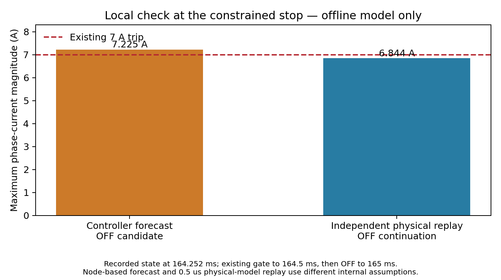

# 离线电流可行性约束：实现与对照验证

2026-10-28，new_mpc/pcmfpc_zcdc_target。仅新增HOST测试模块，未修改MCU代码或生成新OUT。
本轮结论：约束逻辑已实现，但尚不能维持170 V/50 Ω闭环，不得据此上电。

## 代码与语义

- tests/offline_current_limit.c/.h：OCL_run取得既有PC_run_fast的权威预测与gi/gu，先判首段、再筛候选，随后OCL_select_feasible执行过滤后的级联排序。
- policy0：完全调用原快核，输出逐字节保持；policy1：检查初始、首段端点和候选端点；policy2：另检查FULL两子步的已计算节点。
- 过滤在top3和delta预算之前进行。deltaI仍0.02 A，但基准变为best-feasible；这是增加硬可行性约束的工程版本，不是原候选集合语义不变。
- 7 A比较采用>=即拒绝；显式模型裕量本轮为0，仅概念试验，不是经标定的硬件误差裕量。
- 首段已不可行返回OCL_STOP_DELAY(256)，空候选返回OCL_STOP_NO_FEASIBLE(257)。无效输出ID0/valid0不表示OFF已获可行证明。
- 实验plant对拒绝锁存停机、停止当拍外环、禁止自动再启机；原7 A、204 V和5.5 A保护/参考限制均保留。policy0保留原历史路径以核对等价。
- tests/offline_current_limit_test.c覆盖全部255非空候选掩码、producer322回放、1/2/3/8候选、终端角度共同触发/严格改善及异常参数。
- tests/validate_offline_current_limit.py从源码快照生成output中的实验plant；原tests/ti_closed_loop.c不改。tests由CCS工程排除，不进入MCU构建。

该原型额外调用FULL预测用于检查，尚未做DSP计时/资源审计，不能复制进实时路径就宣称仍满足247.75 us窗口。
有限节点检查也不保证节点之间的连续峰值、传感误差或实机安全。

## 已执行结果

2415项HOST组件检查通过。原版PC-OFF/ON两案的CSV和JSON均与pass4逐字节相同。
全部案例使用2 kHz、250 us首段、500 us候选、50 Ω名义工况，运行0.8 s。

| 版本 | PC-OFF/ON结果 | 原7 A触发 | 闭环资格 |
|---|---|---|---|
| 原版/policy0 | 0.1614735 s原过流复现 | 两案均触发 | 不合格 |
| 端点约束/policy1 | 0.164252 s无可行候选，锁存停机 | 未触发 | 提前停机，非成功 |
| 子步节点约束/policy2 | 同样0.164252 s无可行候选，锁存停机 | 未触发 | 提前停机，非成功 |

四组新约束案例全程物理模型峰值约4.49954 A，core/ESO数值错误0。
但控制停止时母线仅约131.587 V，仍未升至170 V，不能把未触发过流说成控制已经合格。
在旧故障producer322上，原电流集合0x12的两个候选都已预测超过7 A；新端点可行集合0x05选择ID3，验证了先过滤再排序。

## 无解点的独立物理局部回放

从policy2的停机记录提取真实物理模型状态（164.252 ms，i≈[0.382924,3.665532,-4.048456] A），
继续原state4至164.5 ms，再分别保持8个候选到165 ms，调用未修改的原plant_step。
每个独立候选在首次达到7 A时停止，不使用越限后的终点；该试验不修改原闭环/保护轨迹。

- 控制器预测首段峰值6.63310 A；独立物理回放到164.5 ms的峰值6.66617 A。
- 控制器认为最好的OFF候选也达7.22515 A，故8个候选全拒绝。
- 独立物理模型中，同一后续OFF候选的区间峰值为6.84386 A、终点约±6.82120 A，没有触发7 A；另外7个保持候选均在7 A停止。
- 从164.252到165 ms，该OFF回放的总母线由131.58690升至140.88772 V，变化约9.30082 V；当前控制预测保持总母线不变。
- 若在停机时立即保持OFF，局部回放峰值约4.41703 A；这是停机动作的局部模型检查，不是完整运行策略。

因此在这个模型状态下，至少有一个局部OFF延续未越限，而当前预测把它拒绝；不能断言2 kHz时物理上所有候选均不可行。
同时不能把该局部延续当作全闭环解决方案或硬件安全证明。预测从滤波ADC状态/Fhat出发，物理回放从真实ISR状态出发，
总母线变化、Fhat冻结、传感和时间近似尚未被单因素隔离，不能认定某一项是唯一根因。



独立物理模型的总母线更新满足：

```
dVdc/dt = (sum((1-Sr)*abs(ir_mid)) - 2*Vdc/Rload) / C_half
```

这里只用于说明现物理模型与固定总母线预测的差异，尚未把该负载相关式加入MCU算法。
后续优先验证母线动态和冻结Fhat对长预测区间的影响，不能靠提高7 A门限、删除停机或调松0.02 A预算掩盖问题。

## 重现与证据

在本子工程目录执行：

```powershell
python tests/validate_offline_current_limit.py
```

默认输出项目根output/ti_pcmfpc_zcdc_port/offline_current_limit/pass1，已非空时拒绝覆盖；
使用--output指定该专用目录下的新目录。支持--clang/--vcvars/--baseline。原pass4需保留用于原版逐字节对照。
原始六案、源码快照、编译日志和决策记录在pass1；独立物理局部回放程序与CSV在同级local_replay。
本轮小型局部回放固定于已记录故障状态，不是另一次完整闭环仿真。

当前已加载/构建的MCU仍为Timing.revision1、kernel10、2 kHz，OUT SHA256：
32406e84a00664d037358e238de2e4591bf2950867419807dc5a7401722353fc。
本轮没有CCS构建/目标写入/烧录/清Trip/删除/Git提交或推送，无需重新加载板卡。
