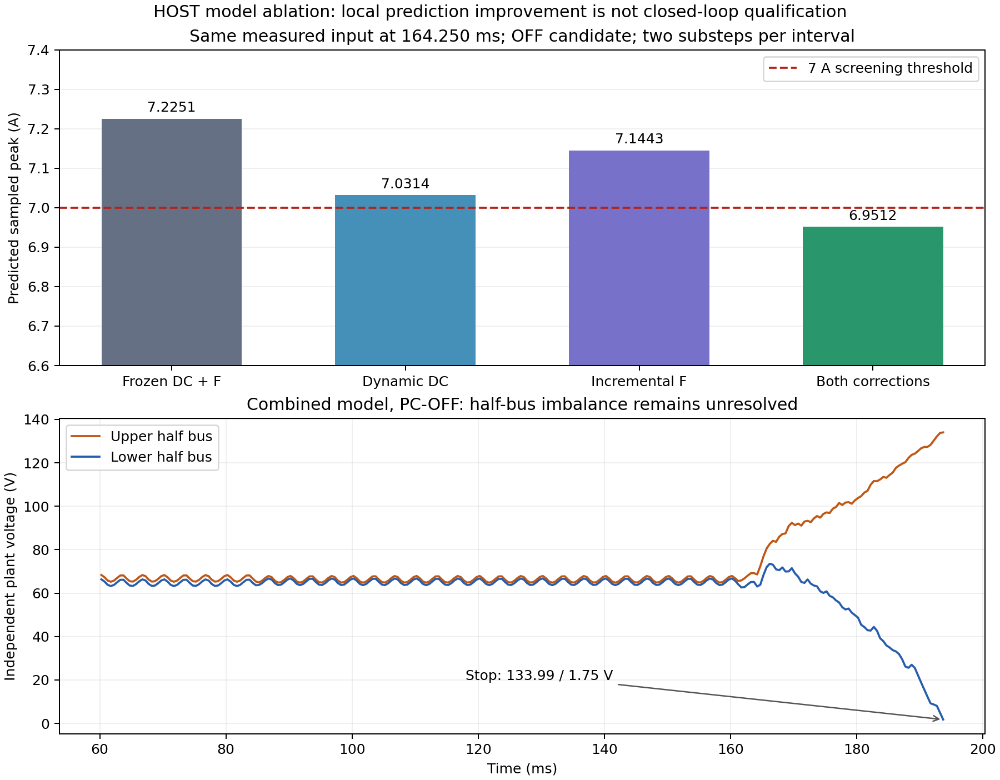

# 2 kHz长预测区间：母线与扰动动态的离线对照

2026-10-28。结论：同一故障输入的预测得到局部改善，但完整170 V闭环仍不合格。
本轮只增加tests内的HOST实验与报告；MCU内核、2 kHz配置、ADC/PWM/CMPSS/Trip Zone及保护参数未修改。

## 实现与对照条件

`tests/validate_prediction_dynamics.py::generate_core`从哈希固定的第十轮内核生成output中的派生C文件，
`generate_limit`让原离线电流约束使用同一派生预测。派生公共符号改名为OD_*，
原`VO_reconstruct`、`VO_update_delta`仍链接未修改的PC_*预测核，避免把观察器变化混入本轮。
`tests/prediction_dynamics_test.c::main`负责契约检查和相同测量输入回放。

每段仍严格两个子步：首段250 us，候选段500 us；float精度、求根器、原独立abc物理模型均保持。
7 A拒绝阈值、204 V滤波软件过压、5.5 A参考限幅、0.02 A排序预算、ZCDC共同触发与严格角度改善均保留。
节点约束的模型余量仍为0，未经过安全标定。约束拒绝时保留锁存停机，不自动再启动。

四种模型只改变如下两项：

| 模型 | 总母线 | dq扰动 |
|---|---|---|
| 0 | 固定 | 冻结，原对照 |
| 1 | 电容电流动态 | 冻结 |
| 2 | 固定 | 保留初始估计的名义状态增量 |
| 3 | 电容电流动态 | 保留初始估计的名义状态增量 |

总母线的子步末更新为：

```text
imid = (iold + inext)/2
dc_next = dc + h/C_half * (sum_OFF abs(imid) - 2*dc/Rload)
np_next = np + h/C_half * sum_ON imid
```

首段末dc1传给全部候选的起点、共用种子及电压可行性判断；每个候选独立推进dc2。
Rload=50 ohm是新增且明确的模型依赖，未证明对负载变化或误差鲁棒。

扰动增量使用原采样时刻的同一个dq0/fhat0锚点，首段到候选不重新锚定：

```text
Fd = fhat0_d - R/L*(id-id0) + omega*(iq-iq0)
Fq = fhat0_q - R/L*(iq-iq0) - omega*(id-id0)
```

这里假设平衡电网的dq电压在预测期间近似不变，保留初始ESO残差；不使用未来真实电压、母线或电流。
派生独立区间入口是私有HOST接口，只允许在同一输入的成功OD_run_fast之后调用，以保持共同锚点。
新trace具有首段和各候选有效标志，失败时不能把零占位解释成真实预测。

## 已执行检查

最终pass2共12312项检查通过：3169+3047+3049+3047。
包括模型0整输出/FULL逐字节一致、原输入不可变、重复计算确定性、候选母线独立复位、
CONTROL/FULL同一模型与锚点、电容电流平衡、all-ON仅负载放电、R=omega=0扰动退化及失败trace无效化。
Clang以`-O2 -Wall -Wextra -Werror`构建所有HOST程序成功。

模型0的PC-OFF/ON两案，CSV、JSON、故障事件和汇总均与上一轮子步约束版逐字节一致。
pass1保留为初次结果；pass2补充trace有效性与检查后重跑八案，为本报告依据，不叠加两轮检查数量。

## 同一故障输入回放

输入来自模型0在164.250 ms的ADC/PLL/ESO记录，ISR约164.252 ms。
四个模型使用完全相同的测量输入和当前门极；均不是从未来真实物理状态出发。
下表是OFF候选的受检节点最大电流，包含共同首段与候选的受检节点：

| 模型 | OFF预测峰值 A | 原7 A筛选 |
|---|---:|---|
| 0 固定母线、冻结扰动 | 7.225150 | 无可行候选，停机 |
| 1 仅母线动态 | 7.031404 | 无可行候选，停机 |
| 2 仅扰动增量 | 7.144296 | 无可行候选，停机 |
| 3 两者组合 | 6.951249 | 仅OFF可行，选择ID1/hw0 |

这证明两项假设会影响该输入的筛选，不能说只有固定母线是唯一原因。
组合模型的预测裕量仅约48.75 mA；没有传感/参数/离散误差的认证界，不能据此放行硬件。
上一轮6.84386 A物理局部回放起点是真实ISR状态，与这里的滤波ADC输入不同，不能直接用两者差值作为预测误差认证。

## 八组完整闭环对照

沿用名义3 mH、0.2 ohm、每半440 uF、50 ohm、100 V线RMS/50 Hz工况，原0.8 s时长和物理保护保持。
此处PC-OFF/ON只指ZCDC末级关闭/开启，PCMFPC阻断预测均启用。

| 模型 | ZCDC | 结果 | 全程物理峰值 A | 170 V闭环 |
|---|---|---|---:|---|
| 0 | OFF/ON | 两案均164.252 ms无可行候选，锁存停机 | 4.499539 | 不合格 |
| 1 | OFF/ON | 两案仍164.252 ms无可行候选，锁存停机 | 4.499539 | 不合格 |
| 2 | OFF | 164.252 ms无可行候选，锁存停机 | 4.483470 | 不合格 |
| 2 | ON | 完成0.8 s，但1480次均选择/施加hw0 | 4.085819 | 不合格 |
| 3 | OFF | 193.752 ms预测半母线合法性失败，锁存停机 | 6.885093 | 不合格 |
| 3 | ON | 完成0.8 s，但1480次均选择/施加hw0 | 4.085819 | 不合格 |

模型2/3的PC-ON物理轨迹一致，全程无开关，表现为二极管整流延续。
0.6~0.8 s总母线均值131.384591 V、参考持续饱和；完成仿真且没有Trip不代表170 V调压成功。

模型3的PC-OFF停机时，真实物理半母线为133.990016 / 1.754908 V，已严重失衡。
首段预测完成，但候选批次在首个候选完成前返回`PC_ERR_MIDPOINT=4`，不能把它说成求根浮点异常或8个候选均无解。
停机后原物理模型继续到194.466 ms出现半母线非正并提前退出；不使用之后的稳态统计。
此前总压峰值约163.8 V也不能作为控制改善的合格证据。



## 下一步及实际固件

先继续离线核查两条决策链：ZCDC为何在参考饱和时持续选OFF，以及中点电位如何在候选筛选/排序后失去约束。
随后核对修正前瞻预测与尚未修正的电压积分重构/ESO之间的残差。
若要研究积分步长，应作为独立的网格收敛试验，不与本轮两步模型比较混称同一个改动。
不得用提高7 A阈值、放宽0.02 A预算或取消锁存来掩盖这些失败。

这些HOST原型额外做FULL预测，且动态模型增加计算；没有DSP计时或资源证据，不能直接移入实时路径。
tests由`.cproject`的`tests|FLASH`排除。当前MCU仍为Timing.revision1/kernel10/2 kHz，OUT SHA256仍为：

```text
32406e84a00664d037358e238de2e4591bf2950867419807dc5a7401722353fc
```

本轮未构建CCS、连接/烧录/写目标/清Trip、删除文件、提交或推送Git；无需重新加载板卡。
当前固件仍只用于已说明的无主功率计时，100 V线RMS/50 ohm带功率运行尚未放行。

## 重现

在本子工程目录执行：

```powershell
python tests/validate_prediction_dynamics.py --output D:/GraduateStudentProject/Vienna_Rectifier/output/ti_pcmfpc_zcdc_port/prediction_dynamics/pass3
```

输出必须是prediction_dynamics证据目录中的新空目录，脚本拒绝覆盖/清理已有结果。
依赖本机保留的上一轮`offline_current_limit/pass1`及其`control_rate_2khz/validation/pass4`源码/原始结果，
因此仅克隆Git工程尚不足以重现这些历史逐字节对照；需要同时保留本地output证据。
可用`--clang`/`--vcvars`指定HOST工具链。默认pass1已非空，不应直接复用。

原始八案、编译日志、执行快照、固定输入与逐拍决策位于项目根output的`prediction_dynamics/pass2`。
本目录的`prediction_dynamics_report.json`为摘要，完整机器报告为output中的`pass2/REPORT.json`。
